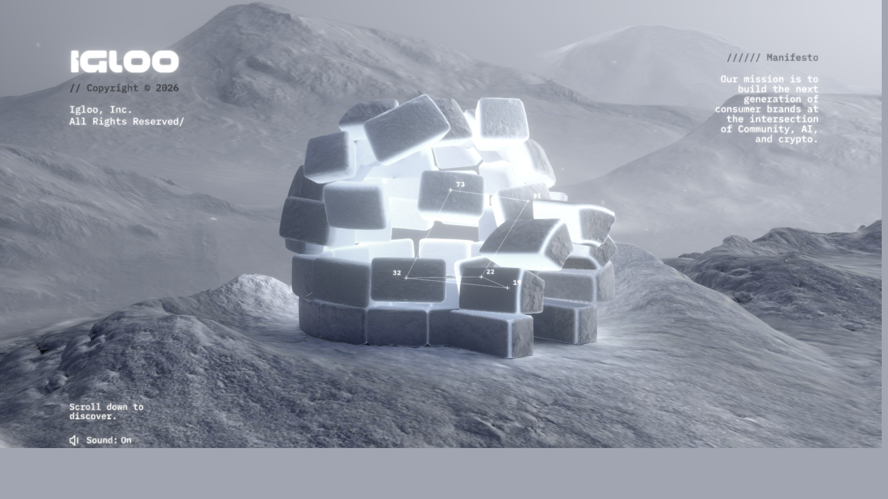

# 01 — Teardown Teknis `www.igloo.inc`

Metode: REA MCP — `capture_browser_scenario` (launch Chromium 156 headless, CDP observation 107 request),
`binary_session` (capability provider), plus analisis statis bundle & header HTTP.
Tidak ada eksploitasi, tidak ada bypass proteksi. Semua bukti diambil dari trafik publik.

---

## 1. Identitas & infrastruktur

| Item | Nilai | Bukti |
|---|---|---|
| Judul | Igloo Inc. | `<title>` |
| Deskripsi | "Our mission is to create the largest onchain community, driving the consumer crypto revolution." | meta description |
| Author / studio | **abeto.co** | `console.log("🧊 by https://abeto.co")` |
| Hosting | **Vercel** (`x-vercel-id: sin1::…`, region Singapore) | response header |
| CDN / proxy | **Cloudflare** (`server: cloudflare`, `cf-cache-status: DYNAMIC`) | response header |
| Stack frontend | Svelte + Vite (build hashed, `assets/`) | `$$.ctx`, `create_fragment`, modulepreload polyfill |
| Service worker | tidak ada | tidak ada request SW |
| Cookie / localStorage | **nol** (kosong semua) | storage capture |
| Analytics / consent banner | tidak ada | 107 request, tidak ada host analytics |
| Console error | **nol** | page-errors: 0 |

Server: `cache-control: public, max-age=0, must-revalidate` untuk dokumen → HTML selalu revalidate,
aset ber-hash di-cache panjang (immutable). Ini pola Vercel standar.

---

## 2. Bentuk halaman (ini kuncinya)

HTML final hanya **1.410 byte**:

```html
<body></body>
<script type="module" crossorigin src="/assets/index-2e130bc1.js"></script>
```

- **Tidak ada** file CSS eksternal. Tidak ada `<div>` konten. Tidak ada font tag.
- Setelah 15 detik + 4× PageDown, teks yang bisa dibaca dari DOM hanya: `Igloo Inc.`
- Struktur DOM setelah render tetap ±3 KB.

Artinya: **UI-nya bukan HTML.** Tidak ada heading, tidak ada paragraf, tidak ada tombol `<button>`.
Semua elemen visual adalah mesh/kulit 3D di dalam canvas:

```
assets/images/ui/logo-datatexture.ktx2     ← logo
assets/images/ui/sound-datatexture.ktx2    ← tombol sound
assets/images/ui/close-datatexture.ktx2    ← tombol close
assets/images/ui/arrow-datatexture.ktx2    ← panah
assets/images/ui/visit-datatexture.ktx2    ← tombol "visit"
assets/fonts/IBMPlexMono-Medium.json       ← MSDF font (bukan woff2 untuk UI 3D)
```

Copy yang tertanam di bundle (di-render sebagai MSDF mesh):

```
"Scroll down to discover."
"Click to explore"
"PORTFOLIO_CO_01 Pudgy Penguins"
"Our mission is to build the next generation of consumer brands at the intersection of Community, AI, and crypto."
"Igloo, Inc.\nAll Rights Reserved."
"REMOVE AFTER PROJECTS ARE COMPLETED"   ← sisa catatan developer, lolos ke produksi
```

**Konsekuensi:** konten tidak bisa di-crawl Google, tidak bisa di-select, tidak bisa dibaca screen reader,
tidak bisa di-translate. Itu harga yang mereka bayar untuk pengalaman ini.

---

## 3. Arsitektur runtime

```
index.html (1,4 KB)
└── index-2e130bc1.js        16,5 KB   ← entry: Svelte loader + runtime + preloader/ curtain
    └── App3D-d68cb154.js   1.486 KB   ← seluruh "dunia": three.js r165 + shader + GSAP + postprocessing
        ├── bitmapworker      → decode bitmap off-main-thread
        ├── exrworker         → decode HDRI/EXR off-main-thread
        ├── msdfworker        → build/parse atlas MSDF font
        ├── audioworker       → analisis audio (sound design)
        ├── libs/basis/basis_transcoder.wasm   → decode KTX2/Basis
        ├── libs/draco/draco_decoder.wasm      → decode geometri .drc
        ├── ~40 aset .ktx2 / .png / .json      (tekstur + data + font)
        └── 20 aset .drc                       (geometri Draco, 543 KB total)
```

DOM final hanya **37 node** — isinya:

```
#document
└── html
    ├── head (20 meta/link/title/meta-OG) + <script type=module> + <style>
    └── body
        └── div#app
            ├── div#webgl
            │   ├── div
            │   │   └── CANVAS  [data-engine, width, height, style]
            │   └── <style> (position:absolute; width:100%; height:100%)
            └── <style>
```

Tidak ada satu pun elemen teks. Tidak ada `<button>`, `<a>`, `<h1>`, ``.

Pola yang dipakai: **code splitting dua tingkat**.
Entry kecil (16 KB) memuat preloader/curtain dulu → baru `import("./App3D.js")` (1,4 MB) di-load
setelahnya. Jadi user melihat sesuatu bergerak sebelum bundle 3D selesai diunduh.

Alur startup (dari kode entry):

```js
const e = new Ht({ target })          // komponen preloader
e.show()
const o = (await import("./App3D-….js")).default
const i = await new o({ target, props }).ready   // App3D mengekspos Promise `ready`
await new Promise(c => e.$on("hidden", …))       // curtain hilang setelah scene siap
```

Ini **asset-gated reveal**: curtain tidak hilang sebelum scene WebGL siap, jadi tidak ada
flash of empty canvas. Detail kecil yang bikin terasa mahal.

---

## 4. Mekanisme kerja: scroll-driven 3D narrative

Ini bagian yang perlu dipahami kalau mau meniru.

### 4.1 Pengendali: **scroll virtual**, bukan native scroll

> **Koreksi (lihat `06-bedah-gerak-dan-suara.md`).** Versi pertama analisis ini menyebut
> "native scroll + ScrollTrigger". Itu salah. `html, body { overflow: hidden }`, wheel
> ditangkap `{ passive: false }` + `preventDefault()`, dan `window.scrollY` selalu 0.
> `ScrollTrigger` hanya ikut ter-bundle (2 kemunculan, keduanya internal library; 0 `scrub`,
> 0 `pin`). GSAP dipakai hanya untuk tween auto-center setelah scroll berhenti.

- Scroll = nilai `targetY2` yang ditambah manual dari delta wheel (`× 0.00075`), lalu diredam dua
  lapis (`lerpFPS` 0.075 → 0.15) dan dijepit supaya tidak pernah lebih dari 0.5625 unit di depan
  posisi visual. Detail angka: `06-bedah-gerak-dan-suara.md` §1.
- **Tidak ada** smooth-scroll library (Lenis / Locomotive / Barba tidak ada di bundle — dicek).
- `CustomEase` ikut di-bundle, tapi dipakai untuk `inOut3` saat snap, bukan untuk kurva kamera.
- Tidak ada `Observer`, tidak ada `SplitText`.

### 4.2 Scroll dikirim ke shader lewat **data texture**, bukan uniform biasa

Aset terbesar di situs ini bukan model 3D, tapi:

```
assets/images/scroll-datatexture.ktx2   1.256 KB   ← file TERBESAR di seluruh situs
assets/images/frost-datatexture.ktx2      132 KB
assets/images/fonts/…-datatexture.ktx2    108 KB
```

Pola "…-datatexture.ktx2" muncul berulang: `numbers-datatexture`, `perlin-datatexture`,
`IBMPlexMono-Medium-datatexture`. Tekniknya: **data numerik (kurva scroll, lookup per-karakter,
noise, layout) dipanggang jadi texture**, lalu di-sample di fragment/vertex shader.

Kenapa begitu? Supaya animasi scroll bisa dibaca GPU secara instan tanpa round-trip JS→uniform setiap frame,
dan supaya bentuk kurva bisa "digambar" oleh desainer di tool lalu di-export sebagai image.
Ini teknik yang membedakan "3D website" dari "website yang ada 3D-nya".

### 4.3 Efek volumetrik: VDB → KTX2 3D texture → raymarch

```
assets/images/volumes/peachesbody_64.ktx2    817 KB    ← volume 64³
assets/images/volumes/x_64.ktx2              311 KB
assets/images/volumes/medium_32.ktx2          44 KB
```

Di bundle ada `this.parent.vdbs`, `currentLink`, `computationMaterial`, `uAdditionalNoise` →
ada sistem multi-volume dengan transisi antar volume dan noise tambahan.
Volume dari Houdini/EmberGen (VDB) di-bake jadi 3D texture KTX2, lalu di-ray-march di shader
(±51 kemunculan pola raymarch/step/`MAX_STEPS`). Hasilnya: asap/wajah volumetrik yang menyala
mengikuti scroll — tanpa video, tanpa sprite.

### 4.4 GPGPU / fluid advection

```
assets/images/cubes/advect.png    27 KB
assets/images/cubes/dot_pattern.ktx2
assets/images/cubes/cube_scene.ktx2
```

`advect.png` + 86 kemunculan `WebGLRenderTarget`/`setRenderTarget` + `computationMaterial`
→ pola **ping-pong FBO**: texture hasil simulasi frame sebelumnya jadi input frame berikutnya
(advection/fluid-ish flow di bagian "cubes"). Ini GPU compute klasik sebelum WebGPU.

Catatan: `webGPU` hanya 1 kemunculan (bukan dipakai), jadi semuanya masih WebGL2.

### 4.5 Post-processing

Library: **@pmndrs/postprocessing** (bukan EffectComposer bawaan three).

Bukti: `EffectComposer`, `RenderPass`, `ShaderPass`, `CopyShader`, `MaskPass`,
`LuminanceMaterial`, pesan `"Convolution effects cannot be merged"`,
`"Could not find mainImage or mainUv function"` (`mainImage` = konvensi GLSL pmndrs).

Efek yang ada di kode: **Selective Bloom**, **Godrays**, **DOF (depth of field)**,
luminance-based blending, dan depth texture. Ini yang memberi look "film" — glow selektif,
bukan bloom seluruh layar.

### 4.6 Tipografi MSDF di dalam 3D

`three-msdf-text-utils` (pesan `"You must specify a MSDF font."`) + `IBMPlexMono-Medium.json`.
Teks di-render sebagai mesh dengan Multi-channel Signed Distance Field → tetap tajam di zoom berapa pun,
bisa diberi distorsi/noise/blur shader, dan bisa "menempel" di permukaan 3D.
Font: **IBM Plex Mono** (Medium + Regular saja — disiplin, 2 weight).

### 4.7 Raycast & kamera

- `three-mesh-bvh` (MeshBVH) → raycast cepat ke terrain/igloo.
- `OrbitControls` ada di bundle (`enableZoom`, `_handleZoomMove`) → dipakai untuk mode
  "Click to explore" (user bisa mengorbit objek), bukan untuk kontrol utama halaman.
- `pointermove`/`mousemove` → parallax ringan.
- `visibilitychange` → pause render saat tab tidak aktif (hemat baterai).

### 4.8 Audio

Web Audio API langsung (`AudioContext` dari three.Audio), plus `audioworker` untuk analisis.
Tidak ada Howler. Ada tombol `sound` di UI 3D → audio **opt-in**, tidak autoplay.

---

## 5. Tech stack lengkap

| Layer | Teknologi | Versi / bukti | Keyakinan |
|---|---|---|---|
| Build | Vite | layout `assets/…-hash.ext`, modulepreload polyfill | observed |
| UI framework | Svelte (compiler legacy mode) | `$$.ctx`, `create_fragment`, `$on/$destroy` | observed |
| 3D engine | three.js | `Aa=165` → **r165** | observed |
| Post FX | @pmndrs/postprocessing | `mainImage`, `Convolution effects`, `LuminanceMaterial` | observed |
| Animasi | GSAP hanya untuk snap (`inOut3`) + CustomEase; kamera via `lerpFPS` sendiri | `0` `scrub`, `0` `pin`, `0` `gsap.to(` di app | observed |
| Teks 3D | three-msdf-text-utils | `"You must specify a MSDF font."` | observed |
| Raycast | three-mesh-bvh | `MeshBVH`, pesan error khas | observed |
| Texture | KTX2 / Basis Universal + Zstd supercompression | `basis_transcoder.wasm`, `ZSTDDecoder` | observed |
| Mesh | Draco (+ Meshopt decoder tersedia) | `draco_decoder.wasm`, `MeshoptDecoder` | observed |
| Audio | Web Audio API (three.Audio) | `AudioContext`, tanpa Howler | observed |
| Worker | 4 worker: bitmap, exr, msdf, audio | `*-worker-*.js` di network log | observed |
| Font | IBM Plex Mono (Medium/Regular) | file woff2 + datatexture | observed |
| Hosting | Vercel + Cloudflare | `x-vercel-id`, `server: cloudflare` | observed |
| Smooth scroll | **tidak ada** | Lenis/Locomotive absen | observed |
| State/analytics | **tidak ada** | storage kosong, 0 request analytics | observed |

React/Vue/Angular: **tidak ada** (tidak ada runtime-nya; `createElement` hanya DOM API).

---

## 6. Bobot & performa (terukur)

- Request saat load penuh: **107** (105× 200, 1× 304, 0 gagal)
- 6,4 MB dari 39 file sampel; top 8:

| Aset | KB |
|---|---|
| `scroll-datatexture.ktx2` | 1.256,3 |
| `cubes/cube3_normal.ktx2` | 1.107,8 |
| `igloo/igloo_exploded_color.ktx2` | 822,5 |
| `volumes/peachesbody_64.ktx2` | 817,0 |
| `igloo/ground_color.ktx2` | 610,7 |
| `igloo/mountain_color.ktx2` | 578,1 |
| `igloo/igloo_color.ktx2` | 520,9 |
| `volumes/x_64.ktx2` | 311,0 |

Yang menarik: JS-nya justru **kecil** (entry 16 KB, main 1,45 MB uncompressed ≈ ±400 KB gzip).
Bobotnya di tekstur, bukan kode. Normal map 1,1 MB itu yang bikin berat — bukan three.js.

**Tidak ada `prefers-reduced-motion`** di bundle (dicek: 0 kemunculan). Ini gap aksesibilitas nyata
yang tidak perlu kamu tiru.

---

## 6b. Pipeline geometri: Draco mentah, bukan glTF

Temuan dari capture ber-GPU (tidak muncul di capture headless):

```
assets/geometries/mountain.drc               11,6 KB
assets/geometries/ground.drc                 18,4 KB
assets/geometries/floor.drc                  39,8 KB
assets/geometries/igloo.drc                 217,6 KB   ← terbesar
assets/geometries/igloo/igloo_cage.drc        5,6 KB
assets/geometries/igloo/igloo_outline.drc    19,9 KB
assets/geometries/igloo/patch.drc             0,2 KB
assets/geometries/intro_particles.drc         2,0 KB
assets/geometries/blurrytext.drc              1,2 KB
assets/geometries/blurrytext_cylinder.drc     5,4 KB
assets/geometries/ceilingsmoke.drc           13,4 KB
assets/geometries/smoke_trail.drc             4,0 KB
assets/geometries/shattered_ring.drc         39,7 KB
assets/geometries/shattered_ring2.drc        42,5 KB
assets/geometries/shattered_ring_smoke.drc   10,0 KB
assets/geometries/cubes/cube1.drc            27,4 KB
assets/geometries/cubes/cube3.drc            39,4 KB
assets/geometries/cubes/background_shapes.drc 0,7 KB
assets/geometries/pudgy.drc                  29,9 KB
assets/geometries/overpass_logo.drc          14,2 KB
                                        TOTAL 542,9 KB
```

**Tidak ada `.glb`/`.gltf` di seluruh situs.** Mereka meng-export geometri langsung dari Blender/Houdini
lewat Draco encoder menjadi buffer mentah, lalu `draco_decoder.wasm` → `BufferGeometry`.
Material, tekstur, dan transform diatur di kode.

Kenapa? Karena `.drc` lebih kecil dan tidak membawa overhead glTF (node hierarchy, material JSON,
animation channel) yang tidak mereka butuhkan. Total semua geometri hanya **543 KB** — lebih kecil
dari satu file `scroll-datatexture.ktx2`. Ini pilihan orang yang paham budget.

Nama file-nya juga membocorkan struktur scene: `igloo` + `igloo_cage` + `igloo_outline` (objek utama
dengan rangka & garis tepi), `mountain`, `floor`, `ground`, `shattered_ring` ×2, `smoke_trail`,
`ceilingsmoke`, `blurrytext`, `pudgy` & `overpass_logo` (dua portofolio brand), `intro_particles`.

---

## 6c. Interaksi: handler di `body`, bukan di canvas

Dari `inspect_web_event_listeners` (CDP `DOMDebugger.getEventListeners`):

| Selector | Listener |
|---|---|
| `canvas` | **tidak ada** |
| `#webgl` | **tidak ada** |
| `div` | tidak ada |
| `body` | **1× `click`** (non-capture, non-passive) — `App3D-d68cb154.js:4219` |

Jadi mereka memakai **event delegation di `body`**: satu handler global yang menghitung koordinat
pointer dan melakukan raycast ke scene. Konsekuensi teknis: elemen canvas tidak perlu menangkap apa pun,
dan seluruh permukaan layar jadi area interaktif ("Click to explore" di mana saja).

Bukti bahwa interaksi berjalan (dari capture ber-GPU):



| Metrik | Sebelum klik (`12-w5`) | Sesudah klik (`explore-mode`) |
|---|---|---|
| Luminance rata-rata | 137,5 | **149,5** |
| Warna unik (sampled) | 665 | **941** |
| Ukuran PNG | 1.426 KB | 1.758 KB |
| Piksel berubah (>40 delta) | — | **60,8 %** |
| Request jaringan baru | — | **0** |

Objek baru muncul tanpa satu pun request tambahan → konfirmasi bahwa semuanya sudah di-preload
sebelum interaksi diizinkan. Ini alasan teknis di balik curtain: bukan sekadar gaya, tapi supaya
"Click to explore" tidak pernah mengejutkan user dengan loading.

---

## 7. Verifikasi lapis kedua (browser ber-GPU)

Capture pertama memakai headless + SwiftShader → render gagal (warna rata `rgb(160,165,177)`).
Capture kedua dijalankan lewat REA dengan **Chrome non-headless (GPU nyata)**, 13 frame,
lalu Evidence-nya di-export dan gambar di-decode dari bundle.

Hasil yang berubah dari kesimpulan awal:

| Temuan | Status |
|---|---|
| Geometri `.drc` (20 file, 543 KB) | **baru** — tidak terlihat di capture headless |
| Curtain preloader = warna solid 1 warna (6,9 KB PNG) | **terkonfirmasi** — `00` dan `01` identik byte-per-byte (sha sama) |
| Semua aset dalam satu burst (98 request) | **mengoreksi** dugaan "preload bertingkat" |
| Handler klik di `body`, canvas tanpa listener | **baru** |
| Mode explore mengubah scene tanpa request baru | **baru** |
| `page-error` sepanjang sesi | **0** di keempat capture |

Frame `00` dan `01` punya SHA256 identik → curtain benar-benar statis, tidak ada animasi
(atau animasinya sudah selesai sebelum frame pertama). Frame `02` langsung 1,66 MB → lompatan dari
"kosong" ke "scene penuh", bukan fade bertahap.

Artifact: `shots/` (14 PNG) + `evidence/bundle.json` (21,7 MB, 4 capture, 324 event).

---

## 8. Batasan analisis (jujur)

1. **Tidak ada source map.** `index-2e130bc1.js.map` mengembalikan HTML (SPA fallback) → kode asli tidak tersedia. Semua kesimpulan dari kode terminifikasi.
2. **Render sudah tervalidasi, tapi tidak "dilihat".** Frame ber-GPU berhasil (14 PNG, 1,4–1,8 MB/frame) dan saya verifikasi lewat metrik (luminansi, jumlah warna unik, delta piksel). Saya tidak punya kemampuan melihat gambar, jadi deskripsi visual tetap terbatas pada angka — buka `shots/index.html` untuk melihatnya sendiri.
3. **State scroll terprobe 5× PageDown + 1 klik.** Bagian paling akhir (footer/kontak) dan state hover belum dipetakan.
4. **Nama internal class terminifikasi.** Pemetaan modul→fitur di atas berbasis string literal yang bertahan (nama uniform, pesan error, path aset), bukan nama file asli.
5. **`data-engine` canvas** tidak berhasil dibaca nilainya (hanya nama atributnya yang terlihat di snapshot DOM). Versi three.js tetap dikonfirmasi dari `Aa=165` di bundle.
6. Semua konten dari target diperlakukan sebagai **data**, bukan instruksi.
